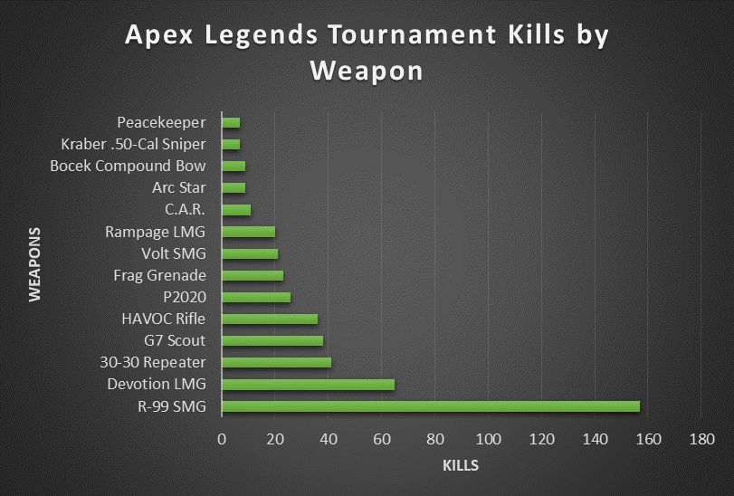

#  Apex Legends Weapon Balancing Insights (EWC Finals)

## 1. The Problem
In high-level competitive Apex Legends, weapon variety keeps the game balanced and exciting. However, data from the Year 5 EWC Finals reveals that professional players are heavily favoring a tiny handful of weapons, completely leaving other weapon classes out of the competitive sandbox.

## 2. The Data Detective Work
I analyzed the official tournament dataset tracking weapon performance. By evaluating the raw kill data, I isolated the weapons dominating the tournament meta and identified the baseline weapons that are currently unviable in professional play.

## 3. The Big Discoveries

* ** The Meta Dictators (Top 3 Kills):** The **R-99 SMG**, **Devotion LMG**, and **30-30 Repeater** completely dominated the tournament. These three weapons dictate close, medium, and long-range professional play.
* ** The Ghost Guns (Bottom 3 Kills):** Despite balance adjustments, the **Mozambique (Akimbo)**, **EVA-8 Auto**, and **Sentinel** sat at the absolute bottom of the performance list. Pro players completely passed them up.

## 4. My Balance Recommendations for Respawn Entertainment
* ** THE NERF (R-99 & Devotion):** Slightly increase the recoil pattern on the R-99 and lower the maximum magazine size on the Devotion LMG to prevent them from suffocating other weapon choices.
* ** THE BUFF (Akimbo Mozambique & Sentinel):** Increase the close-range pellet damage for the Akimbo Mozambique to make it a viable alternative to SMGs, and increase the fire rate of the Sentinel to help it compete with the 30-30 Repeater.
